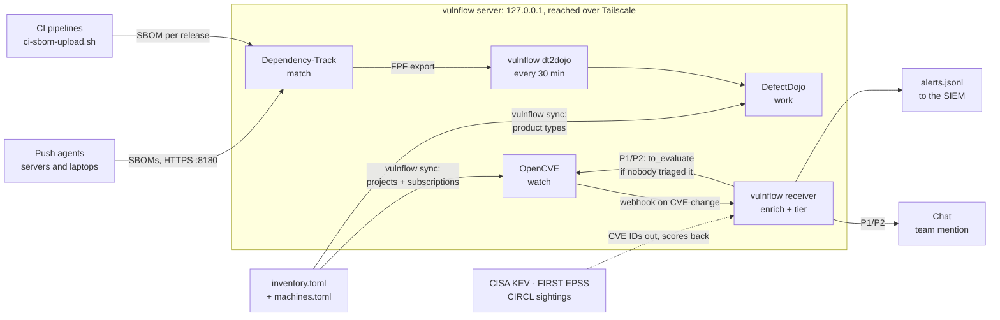
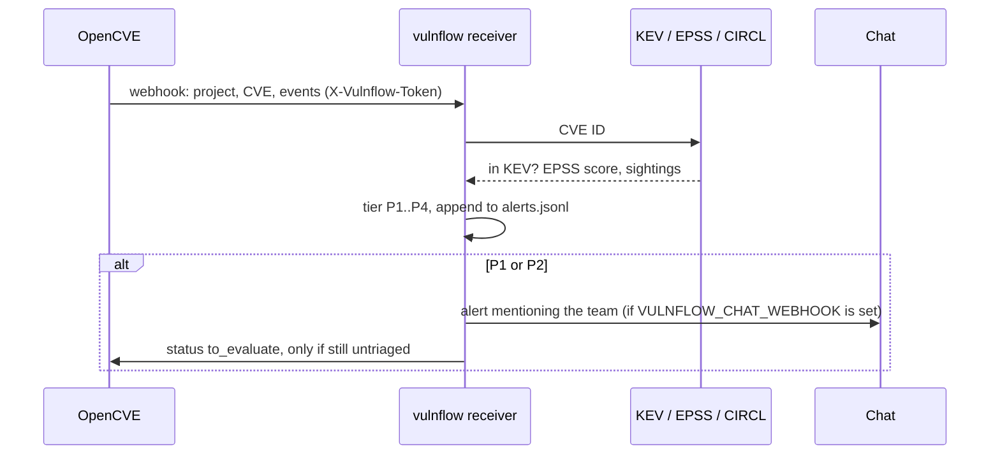

#  vulnflow PoC — CVE tracking per team, from servers and code to network and Windows

A proof of concept for three-layer vulnerability tracking, all self-hosted:

| Layer | Tool | What it answers | Local port |
| --- | --- | --- | --- |
| Watch | **OpenCVE** (self-hosted Community, BSL licence) | "A CVE changed for a vendor/product we use" — per-team projects, tags, status, assignee | 80 (web), 8080 (Airflow) |
| Match | **OWASP Dependency-Track 5.x** (Apache-2.0) | "Which of *our* apps/hosts contain the affected component?" — from SBOMs | 8181 (UI), 8180 (API) |
| Work | **DefectDojo** (BSD-3) | "Who owns this finding, what's its status, is the risk accepted until when?" | 8280 |
| Glue | **vulnflow** (this repo, stdlib Python) | Inventory sync, KEV/EPSS/CIRCL enrichment, priority tiers, routing to teams | 8380 |
| Chat (optional) | **Mattermost Team Edition** (`./poc.sh chat-up`) | Where the P1/P2 alerts show up, if you have no chat of your own | 8065 |

## Documentation

| Page | What is in it |
| --- | --- |
| This README | What it is, install, basic run, daily usage in short |
| [Installation](docs/install.md) | The setup steps one by one, what the bootstraps do, first steps: reaching the UIs, OSV, describing what you run, syft, checking the alert path |
| [SBOMs](docs/sboms.md) | Feeding SBOMs by hand and from CI, and the push agents on your own servers and laptops |
| [Daily usage](docs/operations.md) | How alerts and findings reach you, sysadmin and developer tasks, false positives, the routine, email reports, updates |
| [Teams, tiers and where things live](docs/concepts.md) | How teams map onto the three tools, priority tiers P1-P4, where status and comments are kept |
| [Exposure and criticality](docs/exposure.md) | Proposal: ranking by exposure (network and untrusted input), criticality and patchability, for large organisations |
| [Security](docs/security.md) | OPSEC notes, licences, every external server contacted |
| [Development](docs/development.md) | Tests and checks, what is verified against upstream and what is assumed |

## How it fits together

Two paths run side by side. **Watching** starts from the products you say you use
(`inventory.toml`, plus the private `machines.toml`): OpenCVE reports every CVE change for
them, and the vulnflow receiver ranks it and tells the owning team. **Matching** starts
from what is actually installed: SBOMs from the push agents and CI go to Dependency-Track,
whose findings `dt2dojo` copies into DefectDojo for triage.



One OpenCVE change on its way through the receiver (details in

[Priority tiers](docs/concepts.md#priority-tiers)):



## Install

Requires Docker 25+ with Compose v2, git, openssl, curl, Python 3.11+, ~12 GB RAM for
everything, Debian/Ubuntu host.

```bash
./poc.sh setup
```

That's the whole installation, unattended: it runs
[the setup steps](docs/install.md#the-setup-steps) in order, then
`vulnflow sync --create-projects` (DefectDojo product types, DT coverage) and `status`, and
prints the three logins (passwords are in `.env`). The first run takes about an hour, mostly
OpenCVE's image build and CVE import. Every step is idempotent, so if something fails, fix
it and run `./poc.sh setup` again; it picks up where it stopped.

Then see [first steps after setup](docs/install.md#after-setup-first-steps) and
[SBOMs](docs/sboms.md) to get your hosts and apps into Dependency-Track.

## Basic run

Stopping and starting later (data is kept in Docker volumes):

```bash
./poc.sh down    # stop all stacks
./poc.sh up      # start them again, e.g. after a reboot; no rebuild, no bootstrap
./poc.sh status  # containers and health endpoints
```

`up` uses the images and configuration from the last `setup`; after changing versions
(`DD_REF`, `OPENCVE_REF`, image tags) run `./poc.sh setup` instead.

Upgrading a stack to a version pinned in the repository (database dump first):

```bash
git pull
./poc.sh check-updates          # what is pinned, running and released
./poc.sh upgrade dojo           # or opencve, dtrack
```

See [Updates](docs/operations.md#updates) for what the output means.

To start over from scratch, `./poc.sh destroy` deletes all containers, data volumes,
`upstream/`, `data/` and `.env` (it lists what it will delete and asks you to type
`destroy`; `--yes` skips that). Docker images are kept, so the next `./poc.sh setup` is
faster.

## Daily usage

Mostly automatic: agents upload SBOMs daily, `dt2dojo` copies findings to DefectDojo every
30 minutes, and P1/P2 alerts arrive in chat (with `VULNFLOW_CHAT_WEBHOOK` set).

- **Sysadmin:** triage new CVEs in OpenCVE project `sysadm`, then the host findings in
  DefectDojo.
- **Dev:** upload an SBOM per release from CI; triage the app's findings in DefectDojo.
- **Weekly:** clear known-OK findings (`debian`, `disputed`, `ignore`) and check for hosts
  that stopped pushing (`python3 -m vulnflow machines`).

Daily and weekly email reports (updates, new P1/P2 alerts, new findings, silent hosts):
set `VULNFLOW_REPORT_TO` and run `./poc.sh schedule install`, see
[Email reports](docs/operations.md#email-reports).

In a terminal on the server, `./poc.sh tui` shows findings, alerts, hosts and updates and
can mark findings as false positives or accepted risks.

Details, commands and the monthly routine: [Daily usage](docs/operations.md).
