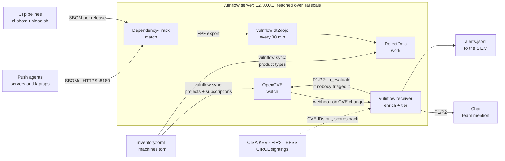
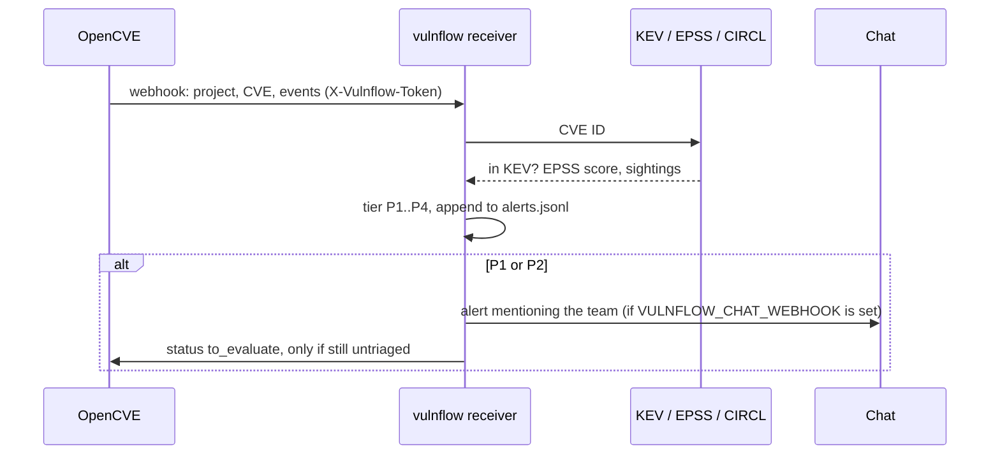
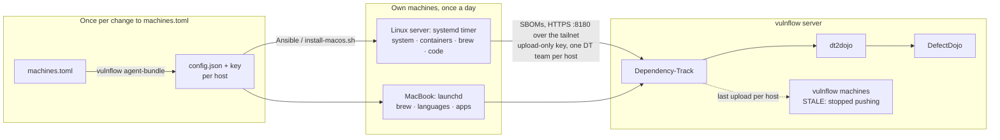

# vulnflow PoC — CVE tracking for the sysadmin, users and dev teams

A proof of concept for three-layer vulnerability tracking, all self-hosted:

| Layer | Tool | What it answers | Local port |
| --- | --- | --- | --- |
| Watch | **OpenCVE** (self-hosted Community, BSL licence) | "A CVE changed for a vendor/product we use" — per-team projects, tags, status, assignee | 80 (web), 8080 (Airflow) |
| Match | **OWASP Dependency-Track 5.x** (Apache-2.0) | "Which of *our* apps/hosts contain the affected component?" — from SBOMs | 8181 (UI), 8180 (API) |
| Work | **DefectDojo** (BSD-3) | "Who owns this finding, what's its status, is the risk accepted until when?" | 8280 |
| Glue | **vulnflow** (this repo, stdlib Python) | Inventory sync, KEV/EPSS/CIRCL enrichment, priority tiers, routing to teams | 8380 |

## Contents

- [How it fits together](#how-it-fits-together)
- [Quick start](#quick-start)
- [After setup: first steps](#after-setup-first-steps)
  - [1. Reach the UIs](#1-reach-the-uis)
  - [2. OSV in Dependency-Track](#2-osv-in-dependency-track)
  - [3. Describe what you run](#3-describe-what-you-run)
  - [4. Install syft](#4-install-syft)
  - [5. SBOM of a server](#5-sbom-of-a-server)
  - [6. SBOM of an app](#6-sbom-of-an-app)
  - [7. See the results](#7-see-the-results)
  - [8. Smoke-test the alert path](#8-smoke-test-the-alert-path)
  - [9. Day to day](#9-day-to-day)
- [Own machines (push agents)](#own-machines-push-agents)
  - [Your hosts: `machines.toml`](#your-hosts-machinestoml)
  - [Rolling out the agents](#rolling-out-the-agents)
  - [What the agents upload](#what-the-agents-upload)
  - [What to expect](#what-to-expect)
- [How the teams work](#how-the-teams-work)
- [Priority tiers](#priority-tiers)
- [Where status and comments live](#where-status-and-comments-live)
- [Security and OPSEC notes](#security-and-opsec-notes)
- [Verified vs assumed](#verified-vs-assumed)
- [Tests](#tests)
- [Licences to be aware of](#licences-to-be-aware-of)
- [External servers](#external-servers)

## How it fits together

Two paths run side by side. **Watching** starts from the products you say you use
(`inventory.toml`, plus the private `machines.toml`): OpenCVE reports every CVE change for
them, and the vulnflow receiver ranks it and tells the owning team. **Matching** starts
from what is actually installed: SBOMs from the push agents and CI go to Dependency-Track,
whose findings `dt2dojo` copies into DefectDojo for triage.



One OpenCVE change on its way through the receiver (details in
[Priority tiers](#priority-tiers)):



## Quick start

Requires Docker 25+ with Compose v2, git, openssl, curl, Python 3.11+, ~12 GB RAM for
everything, Debian/Ubuntu host.

```bash
./poc.sh setup
```

That's the whole installation, unattended: it runs the steps below in order, then
`vulnflow sync --create-projects` (DefectDojo product types, DT coverage) and `status`, and
prints the three logins (passwords are in `.env`). The first run takes about an hour, mostly
OpenCVE's image build and CVE import. Every step is idempotent, so if something fails, fix
it and run `./poc.sh setup` again; it picks up where it stopped.

Stopping and starting later (data is kept in Docker volumes):

```bash
./poc.sh down    # stop all stacks
./poc.sh up      # start them again, e.g. after a reboot; no rebuild, no bootstrap
./poc.sh status  # containers and health endpoints
```

`up` uses the images and configuration from the last `setup`; after changing versions
(`DD_REF`, `OPENCVE_REF`, image tags) run `./poc.sh setup` instead.

### Updates

`./poc.sh check-updates` (run nightly on the server, output in the cron mail) compares, for
DefectDojo, OpenCVE, Dependency-Track and DefectDojo's Valkey, the newest upstream GitHub
release that is at least 7 days old, the version pinned in the repository
(`DD_REF`/`OPENCVE_REF` in `.env.example`, the image tags in
`stacks/dependency-track/docker-compose.yml`, the valkey image in
`stacks/defectdojo/override.yml`) and the running one:

```text
DefectDojo: running 3.5.200, pinned 3.5.201
  UPDATE 3.5.202 released 2026-11-20: bump DD_REF in .env.example after the AGENTS.md checks
  READY  3.5.201 is pinned: ./poc.sh upgrade dojo
  new    3.5.300 (cooldown until 2026-12-01)
```

- **UPDATE**: bump the pin in the repository (Dependency-Track: Dependabot opens the PR).
- **Valkey** is pinned in the DefectDojo overlay ahead of `DD_REF` and bumped by hand (tag
  and digest; Dependabot doesn't read that file). Its release notes say `Upgrade urgency
  SECURITY` when the cooldown is worth skipping. READY means `./poc.sh dojo-up`: Valkey
  only holds DefectDojo's Celery queue and cache.
- **READY**: on the server, `git pull` and `./poc.sh upgrade dojo|opencve|dtrack`. It dumps
  that stack's databases to `data/backups/` (newest 5 kept), sets the version in `.env` and
  reruns the stack's setup steps (clone/checkout, build, migrations on start, bootstrap).
  `./poc.sh upgrade dojo 3.5.202 --now` takes a version that is not the reviewed pin.

To start over from scratch, `./poc.sh destroy` deletes all containers, data volumes,
`upstream/`, `data/` and `.env` (it lists what it will delete and asks you to type
`destroy`; `--yes` skips that). Docker images are kept, so the next `./poc.sh setup` is
faster.

The individual steps, if you want to run or rerun one:

```bash
./poc.sh init               # .env with all secrets generated (chmod 600); rerun fills gaps
./poc.sh check              # tools, free ports, RAM

./poc.sh dtrack-up          # Dependency-Track: http://localhost:8181  (admin pw + API key -> .env)
./poc.sh dojo-up            # DefectDojo:       http://localhost:8280  (admin pw + API key -> .env)

./poc.sh opencve-prepare    # clone OpenCVE + generate config, upstream default passwords replaced
./poc.sh opencve-start      # upstream install steps without the interactive admin prompt
./poc.sh opencve-bootstrap  # admin, org, API token, projects, subscriptions, webhooks; starts the glue
./poc.sh tailscale          # only with VULNFLOW_TS_HOST: tailnet URLs + tailscale serve
```

No clicking through UIs is needed. Every bootstrap step is idempotent and can be rerun on
its own (`dt-bootstrap`, `dd-bootstrap`, `opencve-bootstrap`); keys/tokens are only
replaced when the one in `.env` no longer works. What they do:

1. **Dependency-Track** (`dtrack-up`): changes the forced `admin/admin` password to
   `DT_ADMIN_PASSWORD`, creates team `vulnflow` with `BOM_UPLOAD`,
   `PROJECT_CREATION_UPLOAD`, `VIEW_PORTFOLIO`, `VIEW_VULNERABILITY`, writes its API
   key to `DT_API_KEY`, and enables the OSV vulnerability source for `DT_OSV_ECOSYSTEMS`
   (default `Debian,PyPI`; OSV is off by default in DT 5.2.2).
2. **DefectDojo** (`dojo-up`): starts upstream's compose plus
   [`stacks/defectdojo/override.yml`](stacks/defectdojo/override.yml), so the admin gets
   `DD_ADMIN_PASSWORD`, the Django/AES keys come from `.env` instead of upstream's
   hard-coded defaults, and images match `DD_REF` instead of `:latest`. Then writes the
   admin's API v2 key to `DD_API_KEY`.
3. **OpenCVE** (`opencve-bootstrap`):
   - creates the admin `OPENCVE_ADMIN_USER` (superuser, email pre-verified, org owner) if
     that username doesn't exist yet. `opencve-start` runs upstream's `install.sh` steps one
     by one instead of `start`, which would stop at an interactive `createsuperuser` prompt;
   - creates a non-login service user `vulnflow`, organization `OPENCVE_ORG` and a
     read-write org token via `manage.py shell`
     ([`stacks/opencve/bootstrap_org.py`](stacks/opencve/bootstrap_org.py); OpenCVE has no
     API for these) and writes it to `OPENCVE_TOKEN`;
   - runs `glue-up`, which attaches the receiver to OpenCVE's network as
     `vulnflow-receiver`;
   - creates the projects and subscriptions from `inventory.toml` (API);
   - per project, creates a `vulnflow` webhook notification (`VULNFLOW_WEBHOOK_URL`, header
     `X-Vulnflow-Token`) and a `vulnflow` alert automation that sends it on every change
     ([`stacks/opencve/bootstrap_webhooks.py`](stacks/opencve/bootstrap_webhooks.py), via
     `manage.py shell`). In v3.1.0 a notification only fires through an automation, and the
     API refuses private webhook URLs, with no allow-list until after v3.1.0.

```bash
python3 -m vulnflow sync --dry-run              # what would change
python3 -m vulnflow sync --create-projects      # OpenCVE projects + subscriptions, Dojo product types
./poc.sh glue-up                                # receiver + dt2dojo loop in containers
```

Feed SBOMs:

```bash
# an application, from CI (GitLab/GitHub/Jenkins); needs syft + jq
DT_URL=... DT_API_KEY=... PROJECT_NAME=ärendesystem PROJECT_VERSION=2.4.1 \
  TEAM_TAG=team-dev ./scripts/ci-sbom-upload.sh

# a Linux server (installed packages), tagged for the sysadmin team
sudo ./scripts/host-sbom.sh sysadm

# or by hand
python3 -m vulnflow upload-sbom --team dev --name myapp --version 1.0 --file bom.cdx.json
```

Ad-hoc look-up of any CVE with the same priority logic:

```bash
$ python3 -m vulnflow enrich CVE-2021-44228 CVE-2025-0001
CVE-2021-44228: P1 Act | KEV=yes EPSS=1.0000 (p100) sightings={'exploited': 1424, ...} | in CISA KEV (ransomware use); ...
CVE-2025-0001: P4 Watch | KEV=no EPSS=0.0056 (p47) sightings={'published-proof-of-concept': 3, 'seen': 10} | no CVSS (likely unenriched in NVD ...)
```

(Real output from 2026-11-19.)

## After setup: first steps

A worked example for a typical small estate: a **Debian 13 (trixie)** server running
**nginx** in front of a **Python web app** (Django here, under `/srv/myapp` with a venv).
The sysadmin team owns the server and nginx, the dev team owns the app. Commands run on the
vulnflow host, in the repo directory, unless noted.

### 1. Reach the UIs

Everything listens on `127.0.0.1`. Users and passwords are printed at the end of `setup`
and `up` (passwords are in `.env`). There are two ways in.

**Over Tailscale (a server that is only reachable on the tailnet).** Set
`VULNFLOW_TS_HOST=auto` (or the node's full MagicDNS name) in `.env` before `setup`, or run
`./poc.sh tailscale` afterwards. `tailscale serve` then publishes, on the Tailscale
addresses only and with a MagicDNS HTTPS certificate:

| URL | Service (local port) |
| --- | --- |
| `https://<host>.<tailnet>.ts.net` | OpenCVE (80) |
| `https://<host>.<tailnet>.ts.net:8181` | Dependency-Track UI (8181) |
| `https://<host>.<tailnet>.ts.net:8180` | Dependency-Track API (8180): the DT UI calls it from the browser; SBOM uploads from other tailnet machines can use it too |
| `https://<host>.<tailnet>.ts.net:8280` | DefectDojo (8280) |

The Airflow UI (8080) and the webhook receiver (8380) are not served; use `ssh -L` for
Airflow. `poc.sh` also writes the matching browser-facing URLs to `.env`
(`DT_PUBLIC_API_URL`, `DD_SITE_URL`, `DD_CSRF_TRUSTED_ORIGINS`, `OPENCVE_URL`) and adds
the tailnet origin to OpenCVE's `CSRF_TRUSTED_ORIGINS`; without those the DT UI can't reach
its API and the DefectDojo/OpenCVE login forms fail Django's CSRF check. Empty
`VULNFLOW_TS_HOST` and rerun `./poc.sh tailscale` to remove the serve entries and go back
to localhost URLs.

What the host needs (e.g. from Ansible) before `./poc.sh setup`:

- Tailscale installed and logged in, MagicDNS on, **HTTPS certificates enabled** for the
  tailnet (admin console, DNS page), and the user that runs `poc.sh` allowed to configure
  serve: `sudo tailscale set --operator=<user>`.
- A firewall that drops inbound traffic on the public interface and allows `tailscale0`
  (ssh over the tailnet too, if you want nothing public at all). The stacks don't depend on
  it, since they bind to `127.0.0.1`, but it's the backstop if an upstream bump starts
  publishing on `0.0.0.0` again: Docker-published ports bypass ufw's input rules.
  `./poc.sh check` and `status` list every TCP listener that is not on loopback or a
  Tailscale address.
- Docker with the compose v2 plugin, git, curl, openssl and python3 ≥ 3.11.

**Over ssh.** From your workstation, tunnel the ports:

```bash
ssh -L 8000:127.0.0.1:80 -L 8181:127.0.0.1:8181 -L 8280:127.0.0.1:8280 user@vulnflow-host
```

Then open OpenCVE on <http://localhost:8000>, Dependency-Track on <http://localhost:8181>
and DefectDojo on <http://localhost:8280>.

### 2. OSV in Dependency-Track

Done by `setup`; needed for Debian packages and PyPI.

Dependency-Track 5.2.2 ships with only the NVD source enabled. NVD matches by CPE, which
fits Debian packages and Python libraries poorly. The OSV source matches by package URL and
covers Debian security advisories and PyPI, but it is **off by default**, and Debian is not
in its default ecosystem list (`Go, Maven, npm, NuGet, PyPI`).

`dtrack-up`/`dt-bootstrap` therefore enables OSV and adds the ecosystems in
`DT_OSV_ECOSYSTEMS` (default `Debian,PyPI`; ecosystems already set are kept, and an empty
value leaves OSV alone). Its output shows `OSV source: ...`; if it prints a warning
instead, enable OSV by hand in the DT UI under Administration. The first OSV mirror takes a
while; findings show up after it finishes. Optional: an NVD API key (faster NVD mirroring)
and the GitHub Advisories source (needs a GitHub token).

OSV files Debian's records as `DEBIAN-CVE-YYYY-N`. `debian` and `disputed` look those up by
the CVE id inside; `patches` leaves Debian packages to `debian`, because osv.dev's fix list
for a Debian package mixes the releases (it offered unstable's curl to a trixie host for
CVEs trixie has no fix for).

### 3. Describe what you run

In `inventory/inventory.toml` (in git) and `machines.toml` (not in git).

OpenCVE watches **vendors/products** (CVE level, also for things you have no SBOM for);
Dependency-Track matches **exact package versions** from SBOMs. For this estate:

```toml
[teams.sysadm.opencve]
vendors  = []
[teams.sysadm.opencve.products]
debian = ["debian_linux"]
f5     = ["nginx"]            # nginx CVEs since F5's acquisition
nginx  = ["nginx"]            # older nginx CVEs

[teams.dev.opencve]
vendors  = []
[teams.dev.opencve.products]
python       = ["python"]
djangoproject = ["django"]
```

Names are OpenCVE's (derived from NVD CPEs, `cpe:2.3:a:<vendor>:<product>`), and OpenCVE
rejects names it doesn't know. Check one with the API (404 = no such name):

```bash
set -a; . ./.env; set +a
curl -s -o /dev/null -w '%{http_code}\n' -H @- http://localhost/api/v2/vendors/f5/products/nginx \
  <<<"Authorization: Bearer $OPENCVE_TOKEN"
```

`inventory.toml` is in git, and this repository is public. Keep the broad, team-level
subscriptions there and put the detailed list of what you actually run in `machines.toml`
(not in git), which `vulnflow sync` adds to each team:

```toml
[subscriptions.sysadm.products]
openbsd    = ["openssh"]
postgresql = ["postgresql"]
```

To see what's worth following, let the agents' SBOMs answer:

```bash
python3 -m vulnflow suggest-subscriptions   # --top N, --libraries
python3 -m vulnflow patches                 # open DT findings with a patched release (--team, --json, --osv)
python3 -m vulnflow debian                  # Debian tracker: urgency, update available or already fixed (--action update|fixed, --release, --ignorable)
python3 -m vulnflow vendor --ubuntu --redhat  # Ubuntu / Red Hat verdicts; asks ubuntu.com / access.redhat.com per CVE id (--action update|fixed|wontfix, --json)
python3 -m vulnflow disputed                 # CVEs NVD tags disputed / unsupported-when-assigned, rejected, or lists for every version (--team, --json, --no-nvd, --any-version-years)
python3 -m vulnflow ignore --from review.json  # dry run; --apply writes NOT_AFFECTED to DT
python3 -m vulnflow unignore                    # undo `ignore` from the ledger (data/ignored.jsonl); dry run, --apply writes; --from review.json for older ones; --forget-changed drops findings somebody changed since
python3 -m vulnflow prune                       # what dt2dojo does every round: carry decisions to new versions, deactivate stale ones (dry run; --apply)
python3 -m vulnflow where stdlib --version go1.23.3  # which files (binaries, dist-info) carry a component, per project (--project, --team, --json)
```

It turns every component in each team's Dependency-Track projects into NVD vendor:product
candidates (the component's CPE, often syft's guess, plus the right NVD names for common
packages: OpenSSH is `openbsd:openssh`, curl `haxx:curl`), leaves out what the team already
follows and language libraries (DT matches those by package URL), and asks OpenCVE how many
CVEs each one has. Names OpenCVE doesn't know and ones with fewer than `--min-cves` (1) are
dropped, which also removes wrong vendors that happen to exist; the rest is ranked by the
number of projects, then CVEs, and printed as commented-out `[subscriptions.<team>]` lines
(`--list-skipped` lists what was left out). Nothing is changed: uncomment what you want,
paste it into `machines.toml`, run `sync`.

Then push it, and restart the glue containers so they reload the inventory (it's a
mounted file, so `glue-up` alone doesn't recreate them):

```bash
python3 -m vulnflow sync --dry-run
python3 -m vulnflow sync --create-projects
./poc.sh opencve-bootstrap    # webhook + automation for any new OpenCVE project
docker restart vulnflow-glue-receiver-1 vulnflow-glue-dt2dojo-1
```

### 4. Install syft

syft generates the SBOMs.

On the vulnflow host and on every server you want to inventory. Pinned version, checksum
verified (use `linux_arm64` on ARM):

```bash
V=1.57.2
cd "$(mktemp -d)"
curl -fsSLO "https://github.com/anchore/syft/releases/download/v$V/syft_${V}_linux_amd64.deb"
curl -fsSLO "https://github.com/anchore/syft/releases/download/v$V/syft_${V}_checksums.txt"
sha256sum --ignore-missing -c "syft_${V}_checksums.txt"
sudo apt install "./syft_${V}_linux_amd64.deb"
```

### 5. SBOM of a server

Owned by the sysadmin team. For your own machines the [push agent](#own-machines-push-agents)
does this daily; the commands below are the one-off, by-hand way. On the vulnflow host
itself:

```bash
sudo ./scripts/host-sbom.sh sysadm
```

For **another server**, keep the DT key off it: generate the SBOM there and copy only the
file over.

```bash
# on the app server (excludes as in scripts/host-sbom.sh)
sudo syft scan dir:/ --exclude './proc/**' --exclude './sys/**' --exclude './dev/**' \
  --exclude './run/**' --exclude './home/**' --exclude './tmp/**' \
  --exclude './var/lib/docker/**' -o cyclonedx-json=host.cdx.json -q

# on the vulnflow host
python3 -m vulnflow upload-sbom --team sysadm --name "host:app01.example.org" \
  --version debian-13 --file host.cdx.json --tag kind-host
```

nginx and the system `python3` are Debian packages, so they show up here as
`pkg:deb/debian/...` components and are matched against Debian's advisories, including
fixes Debian backported without changing the upstream version.

### 6. SBOM of an app

Owned by the dev team.

Scan the deployed app directory *with its venv*, so the SBOM lists the exact installed
versions:

```bash
syft scan dir:/srv/myapp -o cyclonedx-json=myapp.cdx.json -q
python3 -m vulnflow upload-sbom --team dev --name myapp --version 1.4.0 \
  --file myapp.cdx.json --tag kind-app
```

Better: do it in CI on every release with [`scripts/ci-sbom-upload.sh`](scripts/ci-sbom-upload.sh)
(scans the checkout or image, uses a DT key with only upload permissions), so each released
version gets its own DT project version.

### 7. See the results

- **Dependency-Track:** projects `host:...` (tag `team-sysadm`) and `myapp` (tag
  `team-dev`) with their components and vulnerabilities, once analysis is done.
- **DefectDojo:** `dt2dojo` copies DT findings every 30 minutes into one product per DT
  project, under the team's product type. To run it now:
  `python3 -m vulnflow dt2dojo`.
- **OpenCVE:** projects `sysadm` and `dev` list the CVEs matching their subscriptions;
  new or changed ones are sent to the receiver by the `vulnflow` automation.
- **Coverage check:** `python3 -m vulnflow sync --dry-run` warns about teams with no SBOM
  in DT yet.

### 8. Smoke-test the alert path

Send the receiver a fake OpenCVE webhook (Log4Shell, which is in CISA KEV, so it should
come out as **P1**). The token goes in on stdin, not on the command line:

```bash
set -a; . ./.env; set +a
cat >/tmp/vf-test.json <<'EOF'
{"organization": "test", "project": "sysadm",
 "changes": [{"cve": {"cve_id": "CVE-2021-44228", "cvss31": 10.0,
                      "description": "smoke test"},
              "events": [{"type": "first_time"}]}]}
EOF
curl -s -H @- --json @/tmp/vf-test.json "http://127.0.0.1:${VULNFLOW_PORT:-8380}/opencve" \
  <<<"X-Vulnflow-Token: $VULNFLOW_WEBHOOK_TOKEN"
docker exec vulnflow-glue-receiver-1 tail -n 1 /app/data/alerts.jsonl
```

The reply is `{"accepted": 1}`, and the last line of `alerts.jsonl` shows the P1 alert. A
log warning that the OpenCVE write-back failed for this CVE is expected: Log4j isn't in
`sysadm`'s subscriptions. To get alerts in chat, set `VULNFLOW_CHAT_WEBHOOK` in `.env` and
run `./poc.sh glue-up`.

### 9. Day to day

- **Sysadmin:** triage new CVEs in OpenCVE project `sysadm` (status, assignee), then
  handle the Debian-package findings in DefectDojo. Rerun the host SBOM after upgrades
  (from cron or config management).
- **Dev:** upload an SBOM per release from CI; triage findings for `myapp` in DefectDojo
  (or with VEX/analysis in DT, which carries over).
- **Both:** P1/P2 alerts arrive in chat (when configured) and are marked `to_evaluate` in
  OpenCVE, but only if nobody has triaged them yet.

#### Clearing known-OK findings

Mark each one once: `prune` (every `dt2dojo` round) copies the decision to later versions of
the same build, and the next round closes the finding in DefectDojo. `ignore` skips findings
that are already marked, so rerunning a step only adds what is new. It applies every row in
the file, so read the file first; `unignore` takes any of it back.

1. **Already fixed by Debian.** NVD compares upstream version numbers, and Debian fixes in
   its own package versions:

   ```bash
   python3 -m vulnflow debian --action fixed --json > fixed.json     # read it, drop rows you disagree with
   python3 -m vulnflow ignore --from fixed.json --justification CODE_NOT_PRESENT            # dry run
   python3 -m vulnflow ignore --from fixed.json --justification CODE_NOT_PRESENT --apply
   ```

   Each analysis says which Debian version fixed it and which is installed.

2. **Disputed, rejected, or "every version" in NVD.** The supplier says it is not a
   vulnerability, the CVE was withdrawn, or (`ANY-VERSION`) NVD's record lists the product
   with version `*` and no version range, so every version ever made matches: an old CVE
   (more than 2 years, `--any-version-years`) on a current version is NVD's data error. Seen:
   72 Safari CVEs from 2005-2012 matching Safari 27.2 on every Mac, 144 findings on two
   laptops. Check each reason (the `NOTE:` text, or product and dates) before agreeing.
   `ANY-VERSION` is a list to review, not a verdict: an old CVE nobody ever fixed is real
   too (2026-11-24: `rsa` 0.9.x and CVE-2023-49092, the Marvin attack, which RustCrypto has
   not fixed). Delete those rows from the file before `ignore`.
   Safari's version changes with every macOS update, so these come back as new findings on
   the new version; rerunning this step marks them again:

   ```bash
   python3 -m vulnflow disputed --json > disputed.json
   python3 -m vulnflow ignore --from disputed.json --state FALSE_POSITIVE            # dry run, then --apply
   ```

3. **Anything else you investigated by hand** (e.g. a `pkg:generic/...` binary on a
   distribution none of the tools cover): write the rows with a `reason`, in the same JSON
   shape, and run `ignore` with the matching `--justification` (`CODE_NOT_PRESENT` when the
   fix is in, `CODE_NOT_REACHABLE` when the code is never run with outside input).

4. **Accepted risks** (it is affected, and you decide to live with it for now, e.g. a
   `debian --action no-fix` row Debian calls minor): record it in Dependency-Track with a
   review date, so it carries over to new versions and comes back by itself:

   ```bash
   python3 -m vulnflow ignore --from accept.json --state EXPLOITABLE --response WILL_NOT_FIX \
       --review-by 2027-03-01            # dry run, then --apply; CAN_NOT_FIX when there is no fix
   ```

   The finding is suppressed (gone from the lists and DefectDojo) until the review date; the
   first `dt2dojo` round after it lifts the suppression and it shows up again, with a
   comment saying why. `--review-by` works with the other states too, for a Not Affected
   you want to look at again.

Not for `ignore`: `debian --action update` and `patches --osv` list real fixes (update the
image or package instead).

#### Recommended routine

| When | What |
| --- | --- |
| Automatically | Agents upload daily; `dt2dojo` (every 30 min) runs `prune` first, then copies to DefectDojo; the server's nightly update runs `check-updates` |
| Weekly | Steps 1-2 above. `debian --action update` and `patches --osv`: what an image/package update would fix, input for the next Renovate merge. `python3 -m vulnflow machines`: hosts that stopped pushing (more than `--stale-days`, 2) |
| After an image update | Nothing: decisions carry over to the new tag, and the old tag is retired at the first `dt2dojo` round after the host's next agent run (2 days after its last upload if the host has no `host:` project). `python3 -m vulnflow prune` shows what the next round will do |
| Monthly | `python3 -m vulnflow unignore` (dry run): what vulnflow has marked, and what somebody changed since (`--apply --forget-changed` drops those from the ledger). `debian --action no-fix`: anything new to accept (step 4) or that Debian has fixed since? `sync --dry-run`: teams without SBOMs |

## Own machines (push agents)

The vulnflow server is always on and every machine **pushes** to it; nothing connects to
the machines. Each server and MacBook runs `scripts/vulnflow-agent.py` once a day (systemd
timer on Linux, launchd on macOS). The agent builds the machine's SBOMs locally with syft,
Homebrew and the app bundles and uploads them to Dependency-Track over the tailnet
(`https://<host>.<tailnet>.ts.net:8180`, see [Reach the UIs](#1-reach-the-uis)). Ownership is
split three ways: **sysadm** gets the servers, **users** the MacBooks, **dev** the code and
containers.



### Your hosts: `machines.toml`

Host names and what runs where are targeting data, and this repository is public. They live
in `machines.toml` next to `.env`, which is gitignored and dockerignored in the same way;
the committed [`machines.example.toml`](machines.example.toml) has placeholders only. Keep the
real file in a private place (your Ansible repo or vault) and copy it to the server
(`VULNFLOW_MACHINES` in `.env` if it lives elsewhere).

```toml
[groups.servers]                 # shared settings for the hosts in the group
team  = "sysadm"
kind  = "linux"
scans = ["system", "containers"]
hosts = ["server1", "server2", "server3"]

[groups.laptops]
team  = "users"
kind  = "macos"                  # default scans: brew, languages, apps
hosts = ["laptop1", "laptop2"]

[hosts.server1]                  # per-host override (or a host without a group)
scans = ["system", "brew", "containers"]

[code.myapp]                     # application code on one of the hosts, owned by dev
host = "server1"
path = "/srv/myapp"
```

`python3 -m vulnflow machines` lists the hosts by group. Once Dependency-Track is up it also
shows each host's last upload and marks hosts as `STALE` when they haven't pushed for
`--stale-days` (default 2) or never did; the exit code is 1 then. With push, a machine that
has gone quiet is the failure you would otherwise not notice. `./poc.sh status` runs it.

### Rolling out the agents

On the server, after a change to `machines.toml`:

```bash
python3 -m vulnflow agent-bundle --all          # or: agent-bundle server1 laptop2
```

This writes `data/agents/<host>/config.json` (what to scan, project names and tags,
`cpe_map`, the DT URL from `VULNFLOW_AGENT_DT_URL` or `DT_PUBLIC_API_URL`) and
`data/agents/<host>/key` (directory 700, files 600). Every host gets **its own**
Dependency-Track team `agent-<host>` with only `BOM_UPLOAD` and `PROJECT_CREATION_UPLOAD`:
a key taken from a laptop can upload SBOMs but can't read the portfolio. Rerunning keeps a
key that still works (`--rotate` forces a new one). `agent-revoke <host>` deletes that team
and every key of that host, for example when a laptop is lost.

Then Ansible copies, per host:

| | Linux server (runs as root) | MacBook (runs as the user) |
| --- | --- | --- |
| agent | `/usr/local/lib/vulnflow-agent/vulnflow-agent.py` | `~/.local/share/vulnflow-agent/vulnflow-agent.py` |
| bundle | `/etc/vulnflow-agent/config.json` + `key` (root, 600) | `~/.config/vulnflow-agent/config.json` + `key` (600) |
| timer | [`deploy/agent/vulnflow-agent.service`](deploy/agent/vulnflow-agent.service) + `.timer` to `/etc/systemd/system/`, `systemctl enable --now vulnflow-agent.timer` (e.g. from an Ansible role) | [`deploy/agent/install-macos.sh`](deploy/agent/install-macos.sh) `server:path/to/vulnflow` does all of it: fetches script, plist and bundle in one ssh, installs [`local.vulnflow.agent.plist`](deploy/agent/local.vulnflow.agent.plist) and loads it (`--uninstall` removes it) |
| tools | syft (pinned), python3; for `containers` docker, or podman with `systemctl enable --now podman.socket` | syft (`brew install syft`); macOS's own `/usr/bin/python3` (3.9) is enough |

The agent is one standard-library-only file and needs nothing else. On Linux it runs as
root: the system scan reads every package database, and the containers scan needs the
docker socket or root's podman socket (syft's `podman:` source talks to the API socket, so
enable `podman.socket`). Rootless podman containers are found through their `conmon`
processes: the agent lists them as their user and has that user export each image as an
OCI archive on stdout into a file under `/var/tmp` (deleted after the scan; needs room for
the largest image), which root then scans. syft itself unpacks every image under a private
directory in `/var/tmp` (its `TMPDIR`), not `/tmp`, which is often a tmpfs smaller than a
large image (Debian 13: half the RAM). Podman never gets a path: rootless podman runs in
the user's mount namespace, which can't see the unit's private `/var/tmp`. Forgejo runner
containers only live while a workflow runs and are skipped: the job (`…_WORKFLOW-<sha256>_JOB-…`),
a docker action's step (`FORGEJO-ACTIONS-TASK-<n>-WORKFLOW-…_STEP-…`, e.g. MegaLinter) and
services. Before 2026-11-24 the step containers were scanned (MegaLinter showed up as
`container:ghcr.io/oxsecurity/megalinter-python`); `prune` retires that project once it
stops being uploaded. The system scan skips home directories, caches (`/var/cache`, `/root/.cache`),
container storage (docker, containerd, podman) and kernel modules (`ProtectKernelModules`
hides them from the unit anyway; the kernel itself comes from `/boot` and dpkg), and no SBOM carries
syft's per-file entries (`SYFT_FILE_METADATA_SELECTION=none`): on a Debian server those are
40,000+ files Dependency-Track can't match. For the Homebrew scan it switches to the user that owns `brew`, because
Homebrew refuses to run as root. Try it by hand first:

```bash
sudo python3 /usr/local/lib/vulnflow-agent/vulnflow-agent.py --dry-run   # scan, upload nothing
python3 ~/.local/share/vulnflow-agent/vulnflow-agent.py --out /tmp/sboms # write the SBOMs
```

Tailscale ACLs: the machines only need to reach the vulnflow server on TCP 8180.

### What the agents upload

| Project | From | Owner (tag) | Version |
| --- | --- | --- | --- |
| `host:<host>` (`kind-host` / `kind-laptop`, `group-<group>`) | the host scans, merged into one SBOM | the host's `team` (sysadm, users) | probed from the OS, e.g. `debian-13`, `macos-15.1` |
| `container:<image>` (`kind-container`, `host-<host>`) | the `containers` scan: every running image of docker, root's podman and users' rootless podman (once; runner jobs skipped) | `containers_team` (dev) | the image tag |
| `code:<name>` (`kind-app`, `host-<host>`) | `[code.<name>]`: a directory with the code and its installed dependencies | the entry's `team` (dev) | `git describe`, or `version` |

A container project is the image name plus its tag, so the same image at different tags on
two hosts is two projects (`container:nginx@1.31.8`, `container:nginx@trixie`; the triage
commands print the version for that reason). The same image name *and* tag on two hosts is
one project, and each host's upload replaces the other's components; for images pulled from
a registry those are the same anyway.

New versions and old ones (`prune`, run by `dt2dojo` at the start of every round, every 30
minutes, so shortly after the agents' daily uploads). Dependency-Track keeps a decision per
project, component and CVE, so a Not Affected on `container:searxng@2026.11.15` would not
apply to `@2026.11.17`, and nothing retired the old version. Per project name and host
(`host-<host>` tag):

- **Carried forward:** a suppressed decision on one version (Not Affected, False Positive,
  or an accepted risk: Exploitable with response Will Not Fix / Can Not Fix) is copied to
  the other active versions for the same component build (identical package URL) and CVE,
  where nobody has triaged the finding yet, with its justification and response. The
  comment says `Carried forward from <project>@<version>: <original reason>; via vulnflow`,
  so `unignore --from` reverts a copy.
- **Shown again after the review date:** a suppressed decision whose comment says `review
  by YYYY-MM-DD` (`ignore --review-by`) is unsuppressed after that day, keeping its state:
  it is back in the lists and in DefectDojo. Copies keep the date, so all versions come
  back together.
- **Deactivated:** a container or code project its host's last agent run did not upload
  (the host's own `host:<host>` project is an hour or more newer): the container was
  removed, or its scan failed (the agent log says which). Otherwise a version not uploaded
  for 2 days while a newer one exists, or the newest one when nothing uploaded it for 7
  days (the host is gone). Its findings in DefectDojo are closed first, by re-importing an
  empty list into its test.
- **Reactivated:** an inactive version uploaded again after it was deactivated: a
  rollback, a container whose scan works again, or a version that runs next to a newer one
  (two postgres containers on one host) and was deactivated while its host was offline.

It uses its own key, `DT_MAINTENANCE_API_KEY` (team `vulnflow-maintenance`, created by
`dt-bootstrap`): writing analyses and (de)activating projects needs `VULNERABILITY_ANALYSIS`
and `PORTFOLIO_MANAGEMENT`, and the latter also allows deleting projects in DT 5.2.2, so the
glue's own key stays read-only. Without that key `dt2dojo` says `skip prune`. `vulnflow
prune` shows what the next round would do (`--apply`, `--superseded-days`, `--gone-days`).
Only projects the agents make (`kind-*` tag) are touched, and never one that was not
uploaded yet.

Python packages installed with apt (`python3-urllib3` and so on) are listed once, as the
Debian package. syft also reads their `dist-info` under `/usr/lib/python3/dist-packages/` and
reports them a second time as `pkg:pypi/...` with the upstream version, which matches every
CVE Debian has backported a fix for (47 findings on four Debian hosts on 2026-11-24, all
such copies). The agent drops a PyPI component whose every location is in that directory;
packages pip installed (`/usr/local/...`, a venv's `site-packages`) stay. syft writes a
`dir:/` scan's paths without the leading slash (`usr/lib/python3/...`, syft 1.57.2), which
the check allows for.

An image's own Go binary without a version gets the image tag. Some projects put their
version only into the linker flags (Grafana does), so the binary's build info has none, and
syft reports the main module as `UNKNOWN` with a CPE whose version is `*`: every CVE the
product ever had matches (204 open findings on two Grafana tags, 102 each). syft's `from-contents` option
guessed `v3.53.4` for Grafana 13.3.1, so it stays off. Instead the agent sets version, purl
and CPE from the tag, only for the binary's main module (`syft:metadata:mainModule`) whose
last path element is the image's name (`github.com/grafana/grafana` in
`docker.io/grafana/grafana`), and only when the tag is a release number (`13.3.1`, not
`latest`); the component gets the property `vulnflow:version-from=image-tag`.

Kernels: a host project lists only the kernel that runs (`uname -r`). Kernel packages that
are installed but not booted (old ones Debian keeps, a new one waiting for a reboot),
`linux-libc-dev` and syft's `/boot/vmlinuz-*` entries are left out, because every kernel CVE
matches them. A packaged running kernel is tracked by its package; a self-built one is added
as `linux_kernel` with the NVD CPE `linux:linux_kernel:<version>`. Container projects carry no
kernel packages. Findings for the dropped ones close in DefectDojo with the next `dt2dojo`
re-import (`close_old_findings`).

Uploading replaces a project's components, so a project is uploaded only if everything that
makes it up worked; otherwise the agent reports `FAIL` and the previous SBOM stays. A failing
container or code project does not hold back the host project or the others; the exit code
is 1 if anything failed (visible in `systemctl status vulnflow-agent` /
`~/Library/Logs/vulnflow-agent.log`). Dependency-Track applies the tags when it creates a
project. An agent key can't change them later, so after moving a host to another group or
team, fix the tags in the DT UI (or delete the project and let the next push recreate it).

| Scan | Run on | What it lists | How it is matched |
| --- | --- | --- | --- |
| `system` | Linux | dpkg/rpm/apk packages (syft on `/`) | OSV (Debian; add `Ubuntu` to `DT_OSV_ECOSYSTEMS` if relevant) |
| `brew` | Linux, macOS | Homebrew formulae and casks (`brew info --json=v2 --installed`) | CPE only, see below |
| `languages` | any | uv tools, pipx venvs, `~/.cargo/bin`, `npm root -g` (syft) | OSV by purl (PyPI, npm) |
| `apps` | macOS | `/Applications` and `~/Applications` bundles (`Info.plist`) | CPE only, see below |
| `containers` | any with docker | running container images (syft on each image) | OSV by purl for language packages, OS packages by distro |

The server itself needs 4-8 GB of swap if it has less than 16 GB RAM, so the first imports
can't get OOM-killed (`./poc.sh check` warns):

```bash
sudo fallocate -l 8G /swapfile && sudo chmod 600 /swapfile
sudo mkswap /swapfile && sudo swapon /swapfile
echo '/swapfile none swap sw 0 0' | sudo tee -a /etc/fstab
```

### What to expect

- **Homebrew and apps have no package-URL type and no OSV data**, so Dependency-Track can only
  match them by CPE, and NVD's vendor name can't be derived from Homebrew metadata. The
  default guess is vendor = product, with a few built-in exceptions (curl, git, openssl,
  python, ...). Expect misses. Pin the ones you care about in `[cpe_map]` of `machines.toml`
  (`ripgrep = "burntsushi:ripgrep"`), and use OpenCVE product subscriptions for the rest:
  they work on vendor/product names and need no SBOM.
- A cask also shows up as an app (two entries for the same program). Harmless, a bit noisy.
- `~/.cargo/bin` only yields components for binaries built with `cargo auditable`; for others
  syft finds nothing.
- OSV has to cover the ecosystems you use: `DT_OSV_ECOSYSTEMS` in `.env` (default
  `Debian,PyPI`; npm is in DT's own default list, `crates.io` and `Ubuntu` are OSV names you
  can add) and rerun `./poc.sh dt-bootstrap`.
- Findings for a fresh upload take a while; the Dependency-Track UI shows the analysis queue.
- Dependency-Track's API server is capped at 2 GB in `stacks/dependency-track/docker-compose.yml`
  (its docs suggest more for a large portfolio); with this few projects that should do, but
  it is the first thing to raise if the JVM runs out of memory.

## How the teams work

Everything is keyed on the team entries in `inventory/inventory.toml`. The example estate has
three groups:

| | sysadm | users | dev |
| --- | --- | --- | --- |
| Owns | the servers | the MacBooks | code and containers |
| OpenCVE project | `sysadm` | `users` | `dev` |
| Dependency-Track tag | `team-sysadm` | `team-users` | `team-dev` |
| DefectDojo product type | `Sysadmin` | `Users` | `Development` |
| Chat mention | `@sysadm` | `@users` | `@dev` |
| DT projects | `host:<server>` | `host:<macbook>` | `container:<image>`, `code:<name>` |

Products that several teams care about can be listed under each. Each team then gets its
own alert and its own status in OpenCVE. A machine's `team` owns its `host:` project; the
containers running on it belong to `containers_team` (default `dev`) and `[code.*]` entries
to their own `team` (default `dev`).

## Priority tiers

The vulnflow receiver ranks every CVE change OpenCVE sends it:

| Tier | Rule (defaults, tune in `[priority]`) | Action |
| --- | --- | --- |
| **P1 Act** | in CISA KEV, or ≥1 `exploited` sighting in CIRCL Vulnerability-Lookup | chat + OpenCVE status `to_evaluate` |
| **P2 Attend** | EPSS ≥ 0.10, or CVSS ≥ 9.0 and EPSS ≥ 0.01 | chat + OpenCVE status `to_evaluate` |
| **P3 Track** | CVSS ≥ 7.0 | log only |
| **P4 Watch** | everything else, including CVEs with **no CVSS** (NVD no longer enriches most CVEs) | log only |

The write-back to OpenCVE (`VULNFLOW_OPENCVE_TRIAGE_MAX_TIER`) **only touches CVEs nobody
has triaged yet**. It never overwrites a status a person set (e.g. `risk_accepted`).
Everything lands in `data/alerts.jsonl`, which you can ship to the SIEM.

## Where status and comments live

Rule of thumb: **"is this a vulnerability here?" is answered in Dependency-Track; "what do
we do about it, who, and by when?" in DefectDojo.** CVEs for products without an SBOM are
followed in OpenCVE.

| Tool | Holds | Why there |
| --- | --- | --- |
| OpenCVE | CVE level ("does Fortinet CVE-X matter to us?"): project status (`to_evaluate … risk_accepted`), assignee, tags, saved views per team | Vendors/products you follow by subscription, appliances and SaaS that have no SBOM |
| Dependency-Track | What is installed where; matching against NVD, OSV, GitHub; **decisions that must survive updates**: Not Affected / False Positive with a justification, and accepted risks (Exploitable + Will Not Fix / Can Not Fix) with a review date (`ignore`, from `debian`, `disputed` or your own review) | `prune` carries these to new versions of the same build and brings a decision back after its review date; suppressed findings leave DefectDojo through the FPF export; they are VEX |
| DefectDojo | The work on what *is* a problem: owner, priority, SLA, notes, Jira link; reports and metrics per team/product; findings from other tools later (pentests, DAST). Filter by host or kind with the `host-*` / `kind-*` / `group-*` tags `dt2dojo` puts on each test and its findings | Built for workflow and reporting; `dt2dojo` re-imports with `close_old_findings`, so a component fixed in DT closes its finding here |

How it is laid out in DefectDojo: a **product type** per team, a **product** per DT project
name (`container:nginx`), one **engagement** `Dependency-Track` per product for the
continuous import, and a **test** per version (`Dependency-Track 1.31.8`). `prune` closes a
version's test once that version is no longer uploaded.

Things that follow from that layout:

- **Decisions in DefectDojo stay with one version.** A finding belongs to its version's
  test; the next image tag is a new test with new findings (checked 2026-11-24: no
  deduplication across the tests). Notes, an owner or a risk acceptance on
  `container:x@1.2` do not move to `@1.3`. Host projects are stable (their version is the OS
  release, e.g. `debian-13`), so a DefectDojo risk acceptance on a host finding lasts until
  the next release; on a container it lasts until the next update. Anything that should
  survive updates belongs in Dependency-Track: accepted risks too (`ignore --state
  EXPLOITABLE --response WILL_NOT_FIX --review-by <date>`, see "Clearing known-OK
  findings"). DefectDojo's importer only maps DT's False Positive; the other decisions
  reach it as suppressed (so: not exported, closed).
- **One test per image name and host would not fix that**: several versions of the same
  image often run side by side on one host (one postgres per application), and they would
  overwrite each other's findings on every import. DT has no project per container to key
  on.
- **The same CVE shows once per running version** (two postgres versions, two findings).
  That is right while both run; after an update the old version's findings close 2 days
  after its last upload.
- **Engagements:** keep the one `Dependency-Track` engagement for the continuous import;
  create your own engagement (with start and end date) for time-boxed work: a pentest, a
  quarterly review, a migration. Do not create one per version or per run; the tests do
  that.
- **Endpoints** are for network findings (host:port, URL) from tools such as ZAP or nuclei.
  Component findings have none, so they are not used; they become worth it once a network
  or web scanner feeds DefectDojo.

## Security and OPSEC notes

- **The inventory is sensitive.** The list of products you run, and especially what is
  unpatched, is targeting data. Keep all of this self-hosted, behind SSO and a TLS reverse
  proxy, on an admin network. Don't put the subscriptions in a SaaS.
- **Your host list stays out of git.** `machines.toml` (hosts, groups, code paths) is
  gitignored and dockerignored like `.env`, and isn't mounted into the glue containers.
  Agent bundles in `data/agents/` hold one upload-only DT key per host (files 600); revoke a
  host with `python3 -m vulnflow agent-revoke <host>`.
- **Enrichment leaks interest, not exposure.** The receiver sends only CVE IDs to CISA (KEV
  file download), FIRST (EPSS) and CIRCL (sightings). You can turn each one off with
  `VULNFLOW_ENRICH_*=0`. For an isolated network, mirror the KEV and EPSS files internally and
  run your own Vulnerability-Lookup instance (`CIRCL_URL`).
- Compose files bind to `127.0.0.1`: for OpenCVE, `opencve-prepare` rewrites upstream's
  all-interfaces ports 80/8080 to `127.0.0.1:`; for DefectDojo, `stacks/defectdojo/override.yml`
  replaces upstream's all-interfaces 8280/8443 with `127.0.0.1` (`ports: !override`).
  Docker-published ports bypass an input-only host firewall, so this matters even behind one.
  `./poc.sh check`/`status` warn about any TCP listener outside loopback and the tailnet.
- With `VULNFLOW_TS_HOST` set, browser access goes through `tailscale serve`: TLS ends in
  tailscaled, which listens only on the node's Tailscale addresses, so only tailnet members
  that your ACLs allow can reach the UIs. Nothing is published with `tailscale funnel`.
- Webhook auth is a shared-secret header compared in constant time. The token must be ≥ 16
  chars, the body ≤ 5 MB, and processing runs on a bounded queue.
- The glue containers run read-only, with no capabilities, `no-new-privileges`, and a non-root
  UID.
- `./poc.sh init` generates every secret in `.env`; the bootstraps replace the DT
  `admin/admin` password, DefectDojo's hard-coded `DD_SECRET_KEY`/`DD_CREDENTIAL_AES_256_KEY`
  and OpenCVE's postgres/Airflow passwords plus Airflow's shared Fernet key and webserver
  `secret_key`. Bootstrap inputs and outputs travel via stdin and
  `.env` (mode 600), never on a command line.
- The receiver is published on `127.0.0.1` only; OpenCVE reaches it over OpenCVE's own
  docker network. OpenCVE v3.1.0's SSRF guard (API/UI only) rejects that private URL, so the
  webhook is written with the Django ORM; only this fixed, operator-set URL bypasses it.
  Editing that notification in the OpenCVE UI will fail validation; rerun
  `opencve-bootstrap` instead.
- The OpenCVE service user `vulnflow` has no usable password (API token only). Re-running
  `opencve-bootstrap` after losing `OPENCVE_TOKEN` revokes the old `vulnflow` token.

## Verified vs assumed

| Item | Status |
| --- | --- |
| OpenCVE API paths (subscriptions, project create, CVE tracker GET/PATCH, status enum) | Checked against the OpenCVE v3.1.0 tag's source; project create + subscriptions also run live |
| OpenCVE webhook payload (`organization`, `project`, `changes[].cve.cve_id/cvss31/description`, `events`) | Checked against v3.1.0 `WebhookNotifier.prepare_payload` |
| Dependency-Track `PUT /api/v1/bom` (JSON + `projectTags`), `/project/tag/{tag}`, FPF export | From DT docs. Paging header handling covers both v4 and v5 |
| DefectDojo `reimport-scan` with FPF scan type + `auto_create_context` | From DefectDojo docs |
| DT bootstrap (`forceChangePassword`, `login`, team, permissions, team key, `team/self`) | Checked against the DT 5.x apiserver source; run live against 5.2.2 |
| DT OSV config (`/api/v2/extension-points/vuln-data-source/extensions/osv/config`, defaults) | **Run live 2026-11-24 against 5.2.2**: `GET` returns the documented `{"config": {...}}` (OSV disabled, `PyPI, npm, Go, Maven, NuGet`), but the `PUT` answers only as `application/problem+json`, so with `Accept: application/json` it was rejected with 406 and `dt-bootstrap` never enabled OSV (only a warning). Now sent with both types; an unchanged config then returns 304 as expected |
| DD bootstrap (`DD_ADMIN_PASSWORD` in `complete_initialization`, `api-token-auth`) | Checked against DefectDojo 3.5.201 source and compose file |
| OpenCVE org/token models | Checked against the v3.1.0 tag; run live |
| OpenCVE webhook notification + alert automation (models, triggers, action format) | Checked against the v3.1.0 tag; offline test with fake models. Delivery not yet seen live |
| KEV / EPSS / CIRCL sightings | Run live on 2026-11-19 (see `enrich` output above) |
| Agent (`scripts/vulnflow-agent.py`): scans, merge, per-project upload | Offline tests with fake tools and a fake DT (exact path, header, body); `brew` + `apps` scans run for real on macOS with its Python 3.9.6; `--dry-run`/`--out` run on a MacBook and as root on a Debian 13 server (2026-11-22), which showed syft's per-file entries (41,925 of 44,988 components), now dropped. root's podman image scanned through `podman.socket`, and uploads to the live DT from the server, by hand and from the systemd timer. The first timer run found the user's 8 rootless containers (`NoNewPrivileges` does not stop `podman ps` as the user) but `podman image save -o /var/tmp/…` failed (the unit's private `/var/tmp`); now streamed through stdout, **not yet rerun** |
| Agent: an image's own Go binary gets the image tag as version (`version_from_tag`) | **Ran live 2026-11-24** on `grafana/grafana:13.3.1` (syft 1.57.2): only `github.com/grafana/grafana` changed, to `13.3.1` in version, purl and CPE (was `UNKNOWN` / `grafana:grafana:*`). Open findings on that component in DT went from 102 to 0, and the tag's active findings in DefectDojo from 121 to 17 after the next `dt2dojo` round. syft's `from-contents` option had guessed `v3.53.4` for the same binary |
| Homebrew JSON shape (`formulae[].installed[].version`, `casks[].installed`) | Checked against a real `brew info --json=v2 --installed` on 2026-11-21; CPE vendors are still guesses (see "What to expect") |
| Per-host agent teams (`agent-bundle`/`agent-revoke`), BOM upload permissions and tags | Checked against the DT 5.2.2 tag (TeamResource, DeleteTeamRequest, BomResource); not yet run live |
| systemd unit / launchd plist (`deploy/agent/`) | plist passes `plutil -lint`; the systemd hardening (ProtectSystem=full, PrivateTmp) run with syft's docker scan on a Debian 13 Raspberry Pi (2026-11-23): a 2.4 GB image failed in the 1.9 GB tmpfs `/tmp` (exit 1, no message under `-q`) and scanned by hand with `TMPDIR` in `/var/tmp`; the agent now does that, and on a Debian 13 server with a 3.8 GB tmpfs `/tmp` the unit (started by hand, 2026-11-23) scanned and uploaded the host and 19 images, the largest 2.5 GB. The agent no longer passes `-q`, so a syft failure now carries syft's error message |
| Tailscale access: DefectDojo `DD_CSRF_TRUSTED_ORIGINS`/`DD_SITE_URL`, OpenCVE `ALLOWED_HOSTS = ["*"]` and nginx forwarding `Host` without the port | Checked against DefectDojo 3.5.201 and OpenCVE v3.1.0 source |
| Tailscale access: `tailscale serve` keeps the `Host` header; DT apiserver allows the cross-origin UI (it already does for `localhost:8181` → `:8180`) | Run on the tailnet 2026-11-22: logins to all three UIs work over `tailscale serve` |
| DT finding/vulnerability/record fields used by `patches`, `debian`, `disputed`, `ignore` (component `uuid`/`purl`/`version`/`project`, vulnerability `uuid`/`description`/`source`/`vulnId`, `patchedVersions`) | **Checked against a real DT, 2026-11-23** (keys printed from a live finding and record). `patchedVersions` exists but is `null` for NVD records, so `patches` finds nothing there |
| `debian` against the real tracker | **Ran live 2026-11-23 and 2026-11-24** (491 findings: 103 `update`, 367 `fixed`, 21 `no-fix`, 0 `unknown`). **Cross-checked 2026-11-24** against a fresh tracker download and the tracker website: 17 rows of openssl, gnupg2, perl, pkgconf and lynx on bookworm and trixie, every fix version and verdict right, including `~deb13uN`/`+deb13uN`, `.1+deb12u2` and old fixes such as perl CVE-2026-4176 `fixed` in 5.10.0-21 (the tracker notes Debian's perl uses the system zlib since 5.10.0-20). All 21 `no-fix` rows still open in the tracker. The JSON shape is confirmed; `nodsa`/`nodsa_reason`/`next_point_update` (on 4,714 trixie entries) are now shown on `no-fix` rows. Rows that looked duplicated were the same image name at two tags on two hosts (now printed as `name@version`). Still unseen on real findings: `fixed_version` `0` (6,240 trixie entries have it, none of ours) and a purl `upstream=` with a version (syft writes it only when the source version differs, e.g. binNMUs) |
| `patches --osv` (osv.dev `v1/query` by purl) | **Ran live 2026-11-23 and 2026-11-24** (2,122 open findings: 758 with a fix, 1,155 unknown, 209 skipped for `UNKNOWN` versions). The fix for the installed branch was **checked against the GHSA/GO advisories** for undici (6.28.0 → 6.28.1, not 7.x), uuid (8.3.2 → 11.1.1, no 8.x fix) and Go stdlib (go1.24.6 → 1.25.8, no 1.24 fix). Go pseudo-versions (`v0.0.0-<time>-<hash>`, a module built from a commit) gave wrong advice (a Prometheus built 2026-11-05 told to go to 0.305.2; a tempo pseudo-version pointed at 2.8.4, which the Go advisory does not list) and are now skipped and counted. Debian purls via OSV not seen (`debian` covers those) |
| `vendor` (Ubuntu `ubuntu.com/security/cves/<id>.json`, Red Hat `hydra/rest/securitydata/cve/<id>.json`) | Record shapes **checked against real responses for CVE-2023-31486 on 2026-11-23** (Ubuntu `packages[].statuses[]` with `ignored`/`needed`; Red Hat `package_state`, `affected_release`). **Assumed, not seen:** Ubuntu `released` (description = fixed version), `not-affected`, `DNE`; the RPM purl form syft writes (`pkg:rpm/redhat/...`, `distro=rhel-8.8`, `epoch`); ran 2026-11-24 on an estate with no Ubuntu or RPM components (`findings on vendor packages: none`), so **not yet run on real findings** |
| `disputed` (NVD yearly feeds, `cveTags`, `vulnStatus`) | **Checked 2026-11-24.** The old `** DISPUTED **` description prefix is gone: NVD's API returns CVE-2018-20225 (pip) with a plain description and `cveTags: [{"tags": ["disputed"]}]`, and DT's copy of the record has neither, so the first live run reported 0 of 2,122 for the wrong reason. Now read from the yearly JSON 2.0 feeds: format, `.meta` sha256 (of the uncompressed JSON) and the 2002 feed holding CVE-1999..2001 checked against real downloads; 2018 has 153 `disputed`, 12 `unsupported-when-assigned`, 1,629 `Rejected`. Streaming the 578 MB 2026 feed takes ~5 s and 113 MB of memory (`json.load` of the 108 MB 2018 feed took 730 MB). **Ran live 2026-11-24**: 22 yearly feeds downloaded in 64 s (12 MB of cached index; a rerun takes 2 s), every CVE id found in a feed, 4 of 2,123 open findings flagged (CVE-2022-32275 and -32276, Grafana, `disputed` in NVD's `cveTags` with a plain description, confirmed against the NVD API) |
| `disputed` ANY-VERSION (NVD configurations: vulnerable CPE match with version `*` and no `version*` range) | **Checked 2026-11-24** against NVD's API and the yearly feeds: CVE-2010-1179 lists `cpe:2.3:a:apple:safari:*` with no range (the iPhone OS condition is OR-ed, not AND-ed), and so do all 72 Safari CVEs on the laptops. Run over the real feeds and the 217 open laptop findings, the rule flagged 154 (Safari 144, qemu 4, coreutils/imagemagick/lynx 2 each) and left the 63 with a version range alone (libssh2, Docker, ffmpeg, wget …). Not yet run through `disputed` on the live DT |
| False matches beyond `ANY-VERSION` (2026-11-24, all 1,326 open findings compared with NVD's rules for the component's own CPE product) | 984 inside an NVD range (real), 194 "every version" (Safari 144 false; `rsa` CVE-2023-49092 7 **real**; lynx, imagemagick, fish, containers/common 7 false; linux_kernel, u-root, qemu, coreutils 36 to check one by one), 111 outside every rule (102 Grafana 13.3.0 `UNKNOWN`, retired by `prune`), 18 not analysed by NVD yet, 8 with a date as bound. Marked False Positive by hand, with the reason in the analysis: CVE-2014-125070 on the Rust crate `console` (another project), CVE-2018-17175 on `marshmallow` 3.2x (Dependency-Track misreads the `3.0.0b9` bound), CVE-2022-48833 on kernel 7.3.6 (only 5.x ranges); VMware Fusion CVE-2026-41702 (`26h1` vs the app's `26.0.1`); ffmpeg CVE-2025-25468/25469 (bound is a git date) |
| `ignore` (`PUT /api/v1/analysis`) | **Ran live 2026-11-24, one finding at a time** (issue #40 items 8-13): dry run, `--apply` (`1 written`, logged), and a second `--apply` reading it back (`0 written, 1 already NOT_AFFECTED and suppressed`). `GET /api/v1/analysis` returns `analysisState`, `isSuppressed`, `analysisJustification`, `analysisResponse` and `analysisComments[]` with `comment`; DT adds its own audit comments (`Analysis: NOT_SET → NOT_AFFECTED`, `Suppressed`). The finding left `debian --action fixed` and DefectDojo's count dropped by one after `dt2dojo`. The UI hides suppressed findings unless they are shown explicitly |
| `unignore`, the ledger, and `ignore` leaving triaged findings alone | **Ran live 2026-11-24** (issue #40 items 14-20): undo from the ledger (`NOT_AFFECTED -> NOT_SET`, DT accepts `NOT_SET` with `isSuppressed` false, the finding is listed again); a finding set to In Triage is kept, `--overwrite` replaces it and `unignore` puts In Triage back; a finding changed to False Positive after `ignore` is left alone; a finding ignored before the ledger is reverted with `--from` (`previous state unknown`, recognised by its `via vulnflow` comment). A left-alone finding stays outstanding in the ledger until it is reverted, or until `unignore --apply --forget-changed` drops it (the other decision then stands) |
| `prune` (carry forward, deactivate/reactivate, close in DefectDojo; team `vulnflow-maintenance`) | Permissions and endpoints **checked against the DT 5.2.2 tag** (AnalysisResource `VULNERABILITY_ANALYSIS`, ProjectResource.patchProject `PORTFOLIO_MANAGEMENT`, `/project/tag` lists inactive projects, finding `analysis.state`/`isSuppressed`, the FPF export leaves suppressed findings out). **Ran live 2026-11-24**: `dt-bootstrap` created the team and key; 52 agent projects in 47 groups; four busybox decisions on a SearXNG image tag were carried to the next tag with state, justification and reason, a second run found nothing to do, and DefectDojo showed 0 active findings for both tags after `dt2dojo`. Deactivation, the DefectDojo close and reactivation **ran live 2026-11-24** (with `set_active` and `close_in_dojo`, the functions `prune` uses): redis-stack and postgres-backup-local retired and closed, three postgres versions running next to a newer one reactivated. They had been deactivated by a manual `prune --superseded-days 0.1`, and the old rule (reactivate only the newest) left them hidden; now any version uploaded within `--superseded-days` comes back. **In the `dt2dojo` loop, 2026-11-25**: the host-scan rule retired 10 projects the hosts' last agent runs no longer uploaded (old tags of grafana, atuin, searxng, valkey, node-exporter, paperless, mealie and both old flaresolverr images), each closed in DefectDojo first; the superseded searxng 2026.11.15 and grafana 13.3.0/13.3.1 tags are inactive with 0 active findings in DefectDojo, their successors still active, and the next dry run had nothing left. DT 5.2.2 answered 304 Not Modified to 7 of 8 deactivations that it did apply (`set_active` now reads the project back) |
| `where` (file paths of a component) | **Seen live 2026-11-24** on DT 5.2.2: `GET /api/v1/component/{uuid}/property` returns syft's `syft:location:0:path` as group `syft`, name `location:0:path` (`usr/bin/geoipupdate` for `stdlib go1.23.3`); the component list leaves properties out. The agent keeping every duplicate's paths is offline-tested only; SBOMs uploaded before it list one path per component |
| Full stack running together | **Not run here** (no Docker daemon in the build environment). Compose files validate with `docker compose config` |

## Tests

```bash
uvx pre-commit@4.7.0 install            # local checks: hygiene, ruff, secrets, markdownlint
uvx pre-commit@4.7.0 run --all-files
```

mypy, the offline pytest suite (fake HTTP transport), super-linter and OSV-Scanner run in
CI (`.github/workflows`); see [AGENTS.md](AGENTS.md). Dependabot (7-day cooldown) covers uv,
GitHub Actions, pre-commit, the Dockerfile base image and the Dependency-Track compose
images; `DD_REF`/`OPENCVE_REF` in `.env` are bumped by hand.

## Licences to be aware of

OpenCVE's self-hosted edition is under the **Business Source License**, which is not
OSI open source. Internal use by an authority is normally fine, but have the licence text
reviewed before you rely on it long term. Dependency-Track is Apache-2.0, DefectDojo BSD-3,
Vulnerability-Lookup AGPL-3.0, and vulnflow is yours.

## External servers

Everything vulnflow and the three stacks contact outside your own network. Own machines
(push agents, CI) only talk to Dependency-Track over the tailnet; nothing on the internet
connects in.

### Installation and upgrades

| Server | What | When |
| --- | --- | --- |
| `github.com` | Clones of OpenCVE (`OPENCVE_REF`) and DefectDojo (`DD_REF`); syft releases (manual install, section 4) | `setup`, `upgrade` |
| `ghcr.io` | Dependency-Track `apiserver` and `frontend` images | `setup`, `upgrade` |
| `registry.defectdojo.com` | DefectDojo `django` and `nginx` images | `setup`, `upgrade` |
| Docker Hub | `postgres`, `valkey`, `nginx`, `redis/redis-stack`, the Airflow base image, `python` (glue and OpenCVE web images) | `setup`, `upgrade` |
| PyPI | Python packages for OpenCVE's locally built images (vulnflow itself has no runtime dependencies) | OpenCVE build |
| `api.github.com` | Newest releases of DefectDojo, OpenCVE, Dependency-Track and Valkey (anonymous, four requests per run; sends nothing about you) | `./poc.sh check-updates` (nightly) |

### Vulnerability data, while running

| Server | Who asks | What leaves the machine | Turn off |
| --- | --- | --- | --- |
| NVD (`nist.gov`) | Dependency-Track's NVD mirror (on by default) | nothing about you: it downloads the whole feed | DT UI, Administration |
| `storage.googleapis.com/osv-vulnerabilities` | Dependency-Track's OSV mirror, for `DT_OSV_ECOSYSTEMS` | nothing about you: it downloads per-ecosystem archives | `DT_OSV_ECOSYSTEMS=` empty before bootstrap, or DT UI |
| GitHub Advisories | Dependency-Track, only if you enable it with a GitHub token (section 2) | the token | off by default |
| `github.com` | OpenCVE's Airflow DAG pulls `opencve/opencve-kb`, `opencve-nvd`, `opencve-redhat`, `CVEProject/cvelistV5`, `cisagov/vulnrichment` | nothing about you: full git repositories | stop the DAG |
| `www.cisa.gov` | receiver enrichment: CISA KEV list (cached 6 h) | nothing about you: one file download | `VULNFLOW_ENRICH_KEV=0` |
| `api.first.org` | receiver enrichment: EPSS score | the CVE ids it alerts on | `VULNFLOW_ENRICH_EPSS=0` |
| `vulnerability.circl.lu` (`CIRCL_URL`) | receiver enrichment: sightings | the CVE ids it alerts on | `VULNFLOW_ENRICH_CIRCL=0`, or your own instance |
| your chat server | receiver alerts (`VULNFLOW_CHAT_WEBHOOK`) | the alert text: CVE, tier, team, links | leave it empty |
| Tailscale | `tailscaled` (coordination server and DERP relays) | node metadata, as for any tailnet member | — |

The `enrich` command uses the same three enrichment sources as the receiver.

### On-demand triage commands

These run only when you start them; nothing is scheduled. `ignore`/`unignore` only talk to
Dependency-Track.

| Command | Server | What leaves the machine |
| --- | --- | --- |
| `debian` | `security-tracker.debian.org` | nothing about you: one public JSON file, downloaded and cached |
| `vendor --ubuntu` | `ubuntu.com` (`/security/cves/<id>.json`) | the CVE ids of open findings on `pkg:deb/ubuntu/...` components, one request each, cached 24 h |
| `vendor --redhat` | `access.redhat.com` (`/hydra/rest/securitydata/cve/<id>.json`) | the CVE ids of open findings on `pkg:rpm/redhat/...` components, one request each, cached 24 h |
| `patches --osv` | `api.osv.dev` (`/v1/query`) | the package URL and version of each component with an open finding DT has no fix for |
| `disputed` | `nvd.nist.gov` (`/feeds/json/cve/2.0/`) | which years your CVE ids are from: one feed per year (8-50 MB), kept until its `.meta` changes; `--no-nvd` skips it |

`vendor` and `patches --osv` reveal which CVEs or packages you have, not only what you are
interested in: unlike the Debian file and the DT mirrors, the request itself is your
inventory. That's why they are opt-in flags. `vendor` says what it is about to send before it
sends it.
