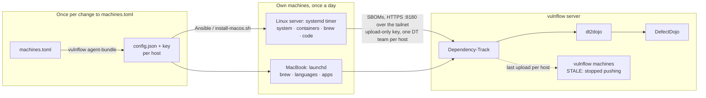

# SBOMs: what gets matched

[Back to the README](../README.md). Dependency-Track matches CVEs against SBOMs. Your
own machines push theirs with the agent; other servers and apps can be scanned by hand or
from CI.

## Feeding SBOMs

```bash
# an application, from CI (GitLab/GitHub/Jenkins); needs syft + jq
# (Forgejo on the tailnet: see "From Forgejo Actions" below)
DT_URL=... DT_API_KEY=... PROJECT_NAME=ärendesystem PROJECT_VERSION=2.4.1 \
  TEAM_TAG=team-dev ./scripts/ci-sbom-upload.sh

# a Linux server (installed packages), tagged for the sysadmin team
sudo ./scripts/host-sbom.sh sysadm

# or by hand
python3 -m vulnflow upload-sbom --team dev --name myapp --version 1.0 --file bom.cdx.json
```

## SBOM of a server

Owned by the sysadmin team. For your own machines the [push agent](#own-machines-push-agents)
does this daily; the commands below are the one-off, by-hand way. On the vulnflow host
itself:

```bash
sudo ./scripts/host-sbom.sh sysadm
```

For **another server**, keep the DT key off it: generate the SBOM there and copy only the
file over.

```bash
# on the app server (excludes as in scripts/host-sbom.sh)
sudo syft scan dir:/ --exclude './proc/**' --exclude './sys/**' --exclude './dev/**' \
  --exclude './run/**' --exclude './home/**' --exclude './tmp/**' \
  --exclude './var/lib/docker/**' -o cyclonedx-json=host.cdx.json -q

# on the vulnflow host
python3 -m vulnflow upload-sbom --team sysadm --name "host:app01.example.org" \
  --version debian-13 --file host.cdx.json --tag kind-host
```

nginx and the system `python3` are Debian packages, so they show up here as
`pkg:deb/debian/...` components and are matched against Debian's advisories, including
fixes Debian backported without changing the upstream version.

## SBOM of an app

Owned by the dev team.

Scan the deployed app directory *with its venv*, so the SBOM lists the exact installed
versions:

```bash
syft scan dir:/srv/myapp -o cyclonedx-json=myapp.cdx.json -q
python3 -m vulnflow upload-sbom --team dev --name myapp --version 1.4.0 \
  --file myapp.cdx.json --tag kind-app
```

Better: do it in CI on every release with [`scripts/ci-sbom-upload.sh`](../scripts/ci-sbom-upload.sh)
(scans the checkout or image, uses a DT key with only upload permissions), so each released
version gets its own DT project version.

## From Forgejo Actions

A Forgejo server on the tailnet can push SBOMs straight to Dependency-Track from its runner,
on every push to `main`, on tags and once a day. Per repository:

1. On the vulnflow server, make the repository its own upload-only key:

   ```bash
   python3 -m vulnflow ci-key myapp          # team ci-myapp; key in data/ci/myapp/key
   ```

   The team `ci-<name>` has only `BOM_UPLOAD` and `PROJECT_CREATION_UPLOAD`, like an
   agent's: the key can create its project and upload SBOMs, and read nothing back.
   Rerunning keeps a key that still works (`--rotate` for a new one); `ci-revoke myapp`
   deletes the team and its keys. The command prints the `DT_URL` to use
   (`VULNFLOW_AGENT_DT_URL` or `DT_PUBLIC_API_URL`, the `tailscale serve` address).
2. In the repository's settings, under Actions: the secret `DT_API_KEY` (the key file's
   content), the variable `DT_URL`, and the variable `DT_TEAM` if the owner is not `dev`.
3. Copy [`deploy/forgejo/sbom.yml`](../deploy/forgejo/sbom.yml) to
   `.forgejo/workflows/sbom.yml` in the repository. It installs syft (pinned, checksum
   verified; a `# renovate:` comment for Renovate's `customManagers:githubActionsVersions`
   preset), scans the checkout and uploads the SBOM as project `<repository>`, version
   `git describe --tags --always`, tags `team-<team>`, `kind-app` and `ci-forgejo`.

Its first step asks `DT_URL/api/version`. If that fails, the job container can't reach
Dependency-Track:

- **Tailscale ACL:** the runner's host must reach the vulnflow server on TCP 8180, as the
  agents do.
- **DNS:** the job runs in a container on a Docker network, and Docker gives containers
  the host's upstream resolvers, not the host's own split DNS (systemd-resolved sending
  `*.ts.net` to Tailscale), so the MagicDNS name may not resolve there. Point the job
  containers at Tailscale's resolver (`--dns 100.100.100.100` in the runner config's
  `container.options`) or run them on the host network (`container.network: host`).

A link checker in the repository's own CI (MegaLinter's lychee) reads the syft download URL
in the workflow as a link and gets a 404, because `${SYFT_VERSION}` is only filled in when
the job runs. Add `https://github.com/anchore/syft/releases/download/` to the repository's
`.lycheeignore`.

The daily run matters: `prune` deactivates the newest version of a `kind-*` project after
7 days without an upload, so a repository that only uploaded on releases would drop out of
the lists. Each commit makes a new version; the old ones are retired two days after a
newer one is uploaded.

## From GitHub releases

A project that builds on GitHub can't reach Dependency-Track when vulnflow is only on the
tailnet. vulnflow pulls instead: the project's release workflow attaches a CycloneDX SBOM
to each release, and every `dt2dojo` round (`python3 -m vulnflow github-sboms` by hand)
downloads the newest one and uploads it. GitHub holds no Dependency-Track key and no
tailnet access, so a compromised workflow or a fork's pull request can't reach your
network.

```toml
# machines.toml (not in git)
[github.someapp]                 # the Dependency-Track project name
repo  = "owner/someapp"
asset = "*.cdx.json"             # default
team  = "dev"
```

- The newest release that is neither a draft nor a prerelease, project `<name>`, version
  = the release tag, tags `team-<team>`, `kind-app` and `source-github`.
- An SBOM that isn't CycloneDX JSON, or lists no package, is refused. Check yours: an SBOM
  of the built wheel (`syft scan dir:dist/`) has no components. Scan an environment the
  release is installed in instead.
- The newest release is uploaded again once a day, also when nothing changed, because
  `prune` retires the newest version after 7 days without an upload; older releases are
  retired two days after a newer one arrives. `data/github-sboms.json` records what was
  uploaded when; `--force` uploads now, `--dry-run` downloads and checks only.
- Public repositories need no token. `VULNFLOW_GITHUB_TOKEN` (read-only) only raises the
  API limit and is never sent with the download, which must be under
  `https://github.com/<repo>/releases/download/`.
- Not done yet: checking the release's cosign signature before the upload.

## Own machines (push agents)

The vulnflow server is always on and every machine **pushes** to it; nothing connects to
the machines. Each server and MacBook runs `scripts/vulnflow-agent.py` once a day (systemd
timer on Linux, launchd on macOS). The agent builds the machine's SBOMs locally with syft,
Homebrew and the app bundles and uploads them to Dependency-Track over the tailnet
(`https://<host>.<tailnet>.ts.net:8180`, see [Reach the UIs](install.md#1-reach-the-uis)). Ownership is
split three ways: **sysadm** gets the servers, **users** the MacBooks, **dev** the code and
containers.



### Your hosts: `machines.toml`

Host names and what runs where are targeting data, and this repository is public. They live
in `machines.toml` next to `.env`, which is gitignored and dockerignored in the same way;
the committed [`machines.example.toml`](../machines.example.toml) has placeholders only. Keep the
real file in a private place (your Ansible repo or vault) and copy it to the server
(`VULNFLOW_MACHINES` in `.env` if it lives elsewhere).

```toml
[groups.servers]                 # shared settings for the hosts in the group
team  = "sysadm"
kind  = "linux"
scans = ["system", "containers"]
hosts = ["server1", "server2", "server3"]

[groups.laptops]
team  = "users"
kind  = "macos"                  # default scans: brew, languages, apps
hosts = ["laptop1", "laptop2"]

[hosts.server1]                  # per-host override (or a host without a group)
scans = ["system", "brew", "containers"]

[code.myapp]                     # application code on one of the hosts, owned by dev
host = "server1"
path = "/srv/myapp"
```

`python3 -m vulnflow machines` lists the hosts by group. Once Dependency-Track is up it also
shows each host's last upload and marks hosts as `STALE` when they haven't pushed for
`--stale-days` (default 2) or never did; the exit code is 1 then. With push, a machine that
has gone quiet is the failure you would otherwise not notice. `./poc.sh status` runs it.

### Rolling out the agents

On the server, after a change to `machines.toml`:

```bash
python3 -m vulnflow agent-bundle --all          # or: agent-bundle server1 laptop2
```

This writes `data/agents/<host>/config.json` (what to scan, project names and tags,
`cpe_map`, the DT URL from `VULNFLOW_AGENT_DT_URL` or `DT_PUBLIC_API_URL`) and
`data/agents/<host>/key` (directory 700, files 600). Every host gets **its own**
Dependency-Track team `agent-<host>` with only `BOM_UPLOAD` and `PROJECT_CREATION_UPLOAD`:
a key taken from a laptop can upload SBOMs but can't read the portfolio. Rerunning keeps a
key that still works (`--rotate` forces a new one). `agent-revoke <host>` deletes that team
and every key of that host, for example when a laptop is lost.

Then Ansible copies, per host:

| | Linux server (runs as root) | MacBook (runs as the user) |
| --- | --- | --- |
| agent | `/usr/local/lib/vulnflow-agent/vulnflow-agent.py` | `~/.local/share/vulnflow-agent/vulnflow-agent.py` |
| bundle | `/etc/vulnflow-agent/config.json` + `key` (root, 600) | `~/.config/vulnflow-agent/config.json` + `key` (600) |
| timer | [`deploy/agent/vulnflow-agent.service`](../deploy/agent/vulnflow-agent.service) + `.timer` to `/etc/systemd/system/`, `systemctl enable --now vulnflow-agent.timer` (e.g. from an Ansible role) | [`deploy/agent/install-macos.sh`](../deploy/agent/install-macos.sh) `server:path/to/vulnflow` does all of it: fetches script, plist and bundle in one ssh, installs [`local.vulnflow.agent.plist`](../deploy/agent/local.vulnflow.agent.plist) and loads it (`--uninstall` removes it) |
| tools | syft (pinned), python3; for `containers` docker, or podman with `systemctl enable --now podman.socket` | syft (`brew install syft`); macOS's own `/usr/bin/python3` (3.9) is enough |

The agent is one standard-library-only file and needs nothing else. On Linux it runs as
root: the system scan reads every package database, and the containers scan needs the
docker socket or root's podman socket (syft's `podman:` source talks to the API socket, so
enable `podman.socket`). Rootless podman containers are found through their `conmon`
processes: the agent lists them as their user and has that user export each image as an
OCI archive on stdout into a file under `/var/tmp` (deleted after the scan; needs room for
the largest image), which root then scans. syft itself unpacks every image under a private
directory in `/var/tmp` (its `TMPDIR`), not `/tmp`, which is often a tmpfs smaller than a
large image (Debian 13: half the RAM). Podman never gets a path: rootless podman runs in
the user's mount namespace, which can't see the unit's private `/var/tmp`. Forgejo runner
containers only live while a workflow runs and are skipped: the job (`…_WORKFLOW-<sha256>_JOB-…`),
a docker action's step (`FORGEJO-ACTIONS-TASK-<n>-WORKFLOW-…_STEP-…`, e.g. MegaLinter) and
services. Before 2026-11-24 the step containers were scanned (MegaLinter showed up as
`container:ghcr.io/oxsecurity/megalinter-python`); `prune` retires that project once it
stops being uploaded. The system scan skips home directories, caches (`/var/cache`, `/root/.cache`),
container storage (docker, containerd, podman) and kernel modules (`ProtectKernelModules`
hides them from the unit anyway; the kernel itself comes from `/boot` and dpkg), and no SBOM carries
syft's per-file entries (`SYFT_FILE_METADATA_SELECTION=none`): on a Debian server those are
40,000+ files Dependency-Track can't match. For the Homebrew scan it switches to the user that owns `brew`, because
Homebrew refuses to run as root. Try it by hand first:

```bash
sudo python3 /usr/local/lib/vulnflow-agent/vulnflow-agent.py --dry-run   # scan, upload nothing
python3 ~/.local/share/vulnflow-agent/vulnflow-agent.py --out /tmp/sboms # write the SBOMs
```

Tailscale ACLs: the machines only need to reach the vulnflow server on TCP 8180.

### What the agents upload

| Project | From | Owner (tag) | Version |
| --- | --- | --- | --- |
| `host:<host>` (`kind-host` / `kind-laptop`, `group-<group>`) | the host scans, merged into one SBOM | the host's `team` (sysadm, users) | probed from the OS, e.g. `debian-13`, `macos-15.1` |
| `container:<image>` (`kind-container`, `host-<host>`) | the `containers` scan: every running image of docker, root's podman and users' rootless podman (once; runner jobs skipped) | `containers_team` (dev) | the image tag |
| `code:<name>` (`kind-app`, `host-<host>`) | `[code.<name>]`: a directory with the code and its installed dependencies | the entry's `team` (dev) | `git describe`, or `version` |

A container project is the image name plus its tag, so the same image at different tags on
two hosts is two projects (`container:nginx@1.31.8`, `container:nginx@trixie`; the triage
commands print the version for that reason). The same image name *and* tag on two hosts is
one project, and each host's upload replaces the other's components; for images pulled from
a registry those are the same anyway.

New versions and old ones (`prune`, run by `dt2dojo` at the start of every round, every 30
minutes, so shortly after the agents' daily uploads). Dependency-Track keeps a decision per
project, component and CVE, so a Not Affected on `container:searxng@2026.11.15` would not
apply to `@2026.11.17`, and nothing retired the old version. Per project name and host
(`host-<host>` tag):

- **Carried forward:** a suppressed decision on one version (Not Affected, False Positive,
  or an accepted risk: Exploitable with response Will Not Fix / Can Not Fix) is copied to
  the other active versions for the same component build (identical package URL) and CVE,
  where nobody has triaged the finding yet, with its justification and response. The
  comment says `Carried forward from <project>@<version>: <original reason>; via vulnflow`,
  so `unignore --from` reverts a copy.
- **Shown again after the review date:** a suppressed decision whose comment says `review
  by YYYY-MM-DD` (`ignore --review-by`) is unsuppressed after that day, keeping its state:
  it is back in the lists and in DefectDojo. Copies keep the date, so all versions come
  back together.
- **Deactivated:** a container or code project its host's last agent run did not upload
  (the host's own `host:<host>` project is an hour or more newer): the container was
  removed, or its scan failed (the agent log says which). Otherwise a version not uploaded
  for 2 days while a newer one exists, or the newest one when nothing uploaded it for 7
  days (the host is gone). Its findings in DefectDojo are closed first, by re-importing an
  empty list into its test.
- **Reactivated:** an inactive version uploaded again after it was deactivated: a
  rollback, a container whose scan works again, or a version that runs next to a newer one
  (two postgres containers on one host) and was deactivated while its host was offline.

It uses its own key, `DT_MAINTENANCE_API_KEY` (team `vulnflow-maintenance`, created by
`dt-bootstrap`): writing analyses and (de)activating projects needs `VULNERABILITY_ANALYSIS`
and `PORTFOLIO_MANAGEMENT`, and the latter also allows deleting projects in DT 5.2.2, so the
glue's own key stays read-only. Without that key `dt2dojo` says `skip prune`. `vulnflow
prune` shows what the next round would do (`--apply`, `--superseded-days`, `--gone-days`).
Only projects the agents make (`kind-*` tag) are touched, and never one that was not
uploaded yet.

Python packages installed with apt (`python3-urllib3` and so on) are listed once, as the
Debian package. syft also reads their `dist-info` under `/usr/lib/python3/dist-packages/` and
reports them a second time as `pkg:pypi/...` with the upstream version, which matches every
CVE Debian has backported a fix for (47 findings on four Debian hosts on 2026-11-24, all
such copies). The agent drops a PyPI component whose every location is in that directory;
packages pip installed (`/usr/local/...`, a venv's `site-packages`) stay. syft writes a
`dir:/` scan's paths without the leading slash (`usr/lib/python3/...`, syft 1.57.2), which
the check allows for.

An image's own Go binary without a version gets the image tag. Some projects put their
version only into the linker flags (Grafana does), so the binary's build info has none, and
syft reports the main module as `UNKNOWN` with a CPE whose version is `*`: every CVE the
product ever had matches (204 open findings on two Grafana tags, 102 each). syft's `from-contents` option
guessed `v3.53.4` for Grafana 13.3.1, so it stays off. Instead the agent sets version, purl
and CPE from the tag, only for the binary's main module (`syft:metadata:mainModule`) whose
last path element is the image's name (`github.com/grafana/grafana` in
`docker.io/grafana/grafana`), and only when the tag is a release number (`13.3.1`, not
`latest`); the component gets the property `vulnflow:version-from=image-tag`.

Kernels: a host project lists only the kernel that runs (`uname -r`). Kernel packages that
are installed but not booted (old ones Debian keeps, a new one waiting for a reboot),
`linux-libc-dev` and syft's `/boot/vmlinuz-*` entries are left out, because every kernel CVE
matches them. A distro's running kernel is tracked by its package; a self-built one is added
as `linux_kernel` with the NVD CPE `linux:linux_kernel:<version>`. That includes kernels
packaged with `make bindeb-pkg` (source package `linux-upstream`): all of those packages,
running or not, are left out, since no distro tracks them. Container projects carry no
kernel packages. Findings for the dropped ones close in DefectDojo with the next `dt2dojo`
re-import (`close_old_findings`).

Uploading replaces a project's components, so a project is uploaded only if everything that
makes it up worked; otherwise the agent reports `FAIL` and the previous SBOM stays. A failing
container or code project does not hold back the host project or the others; the exit code
is 1 if anything failed (visible in `systemctl status vulnflow-agent` /
`~/Library/Logs/vulnflow-agent.log`). Dependency-Track applies the tags when it creates a
project. An agent key can't change them later, so after moving a host to another group or
team, fix the tags in the DT UI (or delete the project and let the next push recreate it).

| Scan | Run on | What it lists | How it is matched |
| --- | --- | --- | --- |
| `system` | Linux | dpkg/rpm/apk packages (syft on `/`) | OSV (Debian; add `Ubuntu` to `DT_OSV_ECOSYSTEMS` if relevant) |
| `brew` | Linux, macOS | Homebrew formulae and casks (`brew info --json=v2 --installed`) | CPE only, see below |
| `languages` | any | uv tools, pipx venvs, `~/.cargo/bin`, `npm root -g` (syft) | OSV by purl (PyPI, npm) |
| `apps` | macOS | `/Applications` and `~/Applications` bundles (`Info.plist`) | CPE only, see below |
| `containers` | any with docker | running container images (syft on each image) | OSV by purl for language packages, OS packages by distro |

The server itself needs 4-8 GB of swap if it has less than 16 GB RAM, so the first imports
can't get OOM-killed (`./poc.sh check` warns):

```bash
sudo fallocate -l 8G /swapfile && sudo chmod 600 /swapfile
sudo mkswap /swapfile && sudo swapon /swapfile
echo '/swapfile none swap sw 0 0' | sudo tee -a /etc/fstab
```

### What to expect

- **Homebrew and apps have no package-URL type and no OSV data**, so Dependency-Track can only
  match them by CPE, and NVD's vendor name can't be derived from Homebrew metadata. The
  default guess is vendor = product, with a few built-in exceptions (curl, git, openssl,
  python, ...). Expect misses. Pin the ones you care about in `[cpe_map]` of `machines.toml`
  (`ripgrep = "burntsushi:ripgrep"`), and use OpenCVE product subscriptions for the rest:
  they work on vendor/product names and need no SBOM.
- A cask also shows up as an app (two entries for the same program). Harmless, a bit noisy.
- `~/.cargo/bin` only yields components for binaries built with `cargo auditable`; for others
  syft finds nothing.
- OSV has to cover the ecosystems you use: `DT_OSV_ECOSYSTEMS` in `.env` (default
  `Debian,PyPI,crates.io`; npm is in DT's own default list, `Ubuntu` is an OSV name you can
  add) and rerun `./poc.sh dt-bootstrap`. Without `crates.io`, Rust projects (from CI) show
  0 findings because nothing matches their crates: they have no CPEs for NVD.
- Findings for a fresh upload take a while; the Dependency-Track UI shows the analysis queue.
- Dependency-Track's API server is capped at 2 GB in `stacks/dependency-track/docker-compose.yml`
  (its docs suggest more for a large portfolio); with this few projects that should do, but
  it is the first thing to raise if the JVM runs out of memory.
